# Poly Haven: Nature models

**12 assets from [Poly Haven](https://polyhaven.com), dedicated to the public domain under [CC0](https://polyhaven.com/license).** Use them in any game, free or paid, and change them however you like; no credit is needed.

3D models as glTF at 1K and 2K texture resolution, each folder self-contained (`.gltf`, `.bin`, `textures/`). 1.5 GB in all.

This is a copy kept by [zuujis-cc0](https://github.com/zuujis-cc0) so game makers can take single files from GitHub. It is not made by or affiliated with Poly Haven: the originals, often in more formats and higher resolutions, are on [polyhaven.com](https://polyhaven.com). If they help you, consider [supporting Poly Haven](https://www.patreon.com/polyhaven/overview).

Every file is listed in [MANIFEST.tsv](MANIFEST.tsv) with its size and SHA-256. More free assets: [the Zuujis collection](https://github.com/zuujis-cc0/free-game-assets#readme).

| | | | |
| :-: | :-: | :-: | :-: |
| <a href="fir_tree_01">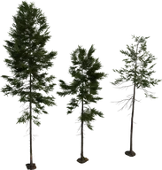</a> <b><a href="fir_tree_01">Fir Tree 01</a></b> by Rico Cilliers, Rob Tuytel · <a href="https://polyhaven.com/a/fir_tree_01">source</a> | <a href="flower_empodium">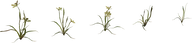</a> <b><a href="flower_empodium">Flower Empodium</a></b> by Jenelle van Heerden, Rico Cilliers · <a href="https://polyhaven.com/a/flower_empodium">source</a> | <a href="flower_gazania">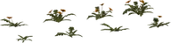</a> <b><a href="flower_gazania">Flower Gazania</a></b> by James Ray Cock, Jenelle van Heerden · <a href="https://polyhaven.com/a/flower_gazania">source</a> | <a href="flower_heliophila">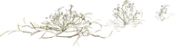</a> <b><a href="flower_heliophila">Flower Heliophila</a></b> by Jenelle van Heerden · <a href="https://polyhaven.com/a/flower_heliophila">source</a> |
| <a href="flower_stinkkruid">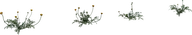</a> <b><a href="flower_stinkkruid">Flower Stinkkruid</a></b> by Jenelle van Heerden, Rico Cilliers · <a href="https://polyhaven.com/a/flower_stinkkruid">source</a> | <a href="flower_ursinia">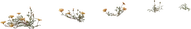</a> <b><a href="flower_ursinia">Flower Ursinia</a></b> by Jenelle van Heerden, Rico Cilliers · <a href="https://polyhaven.com/a/flower_ursinia">source</a> | <a href="grass_bermuda_01">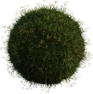</a> <b><a href="grass_bermuda_01">Grass Bermuda 01</a></b> by Rico Cilliers · <a href="https://polyhaven.com/a/grass_bermuda_01">source</a> | <a href="grass_medium_01">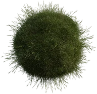</a> <b><a href="grass_medium_01">Grass Medium 01</a></b> by Rico Cilliers, Rob Tuytel · <a href="https://polyhaven.com/a/grass_medium_01">source</a> |
| <a href="grass_medium_02">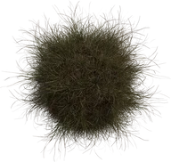</a> <b><a href="grass_medium_02">Grass Medium 02</a></b> by Rico Cilliers · <a href="https://polyhaven.com/a/grass_medium_02">source</a> | <a href="island_tree_01">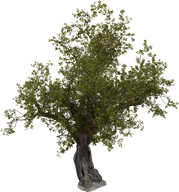</a> <b><a href="island_tree_01">Island Tree 01</a></b> by Rico Cilliers, Rob Tuytel · <a href="https://polyhaven.com/a/island_tree_01">source</a> | <a href="island_tree_02">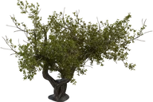</a> <b><a href="island_tree_02">Island Tree 02</a></b> by Rico Cilliers, Rob Tuytel · <a href="https://polyhaven.com/a/island_tree_02">source</a> | <a href="island_tree_03">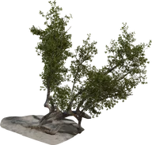</a> <b><a href="island_tree_03">Island Tree 03</a></b> by Rico Cilliers, Rob Tuytel · <a href="https://polyhaven.com/a/island_tree_03">source</a> |

---

Kept up to date by this repository's own [update workflow](.github/workflows/update.yml), with code and plan from [cc0-mirror](https://github.com/zuujis-cc0/cc0-mirror). Something wrong? [Open an issue there](https://github.com/zuujis-cc0/cc0-mirror/issues/new) or use the [private report form](https://games.zuujis.com/report).
